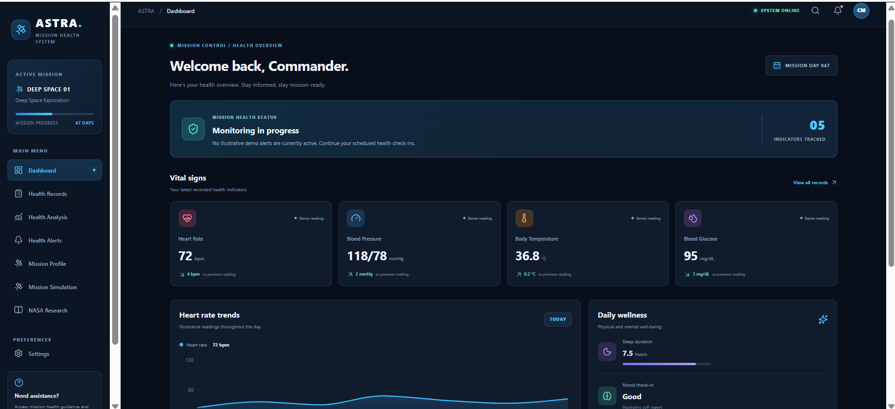
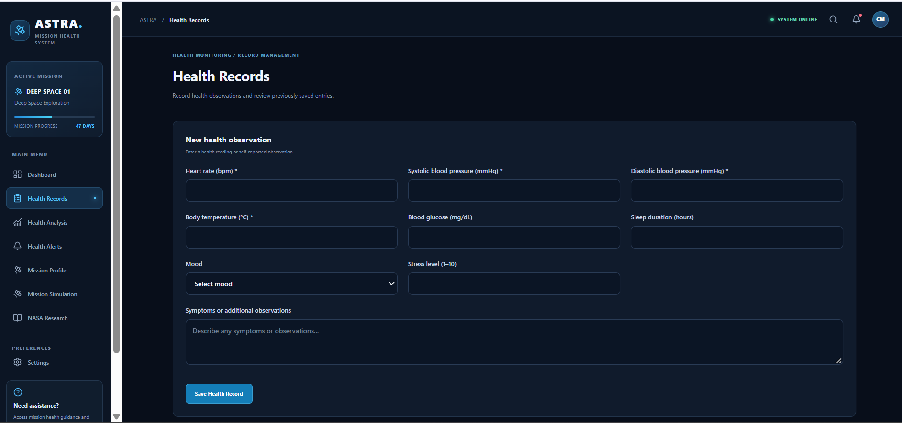
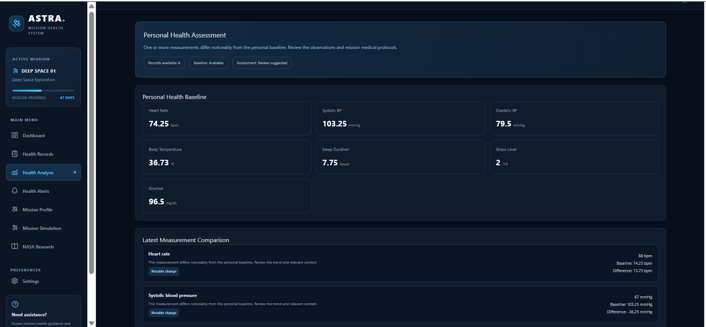
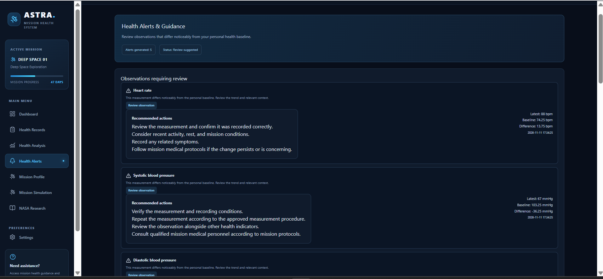
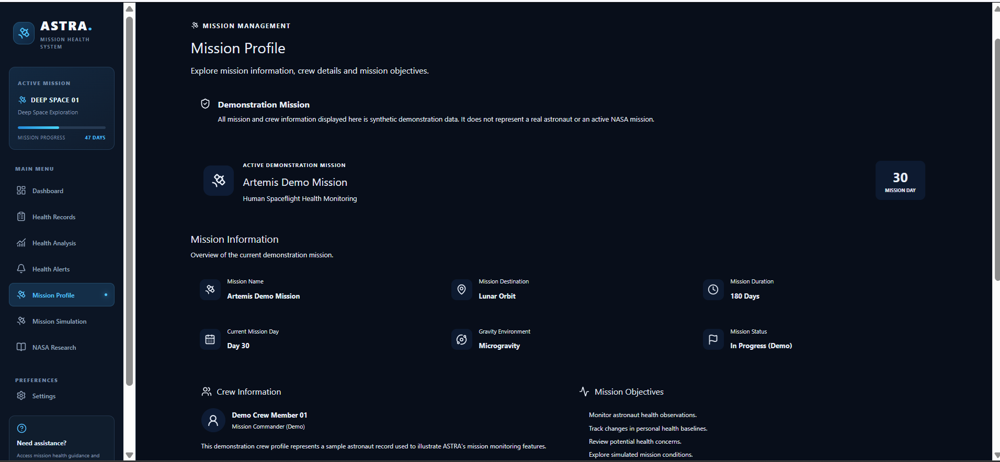
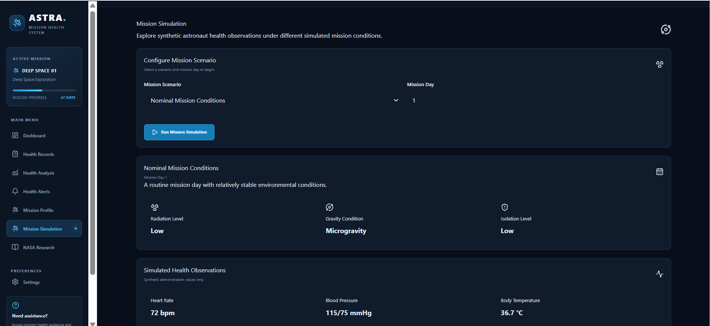
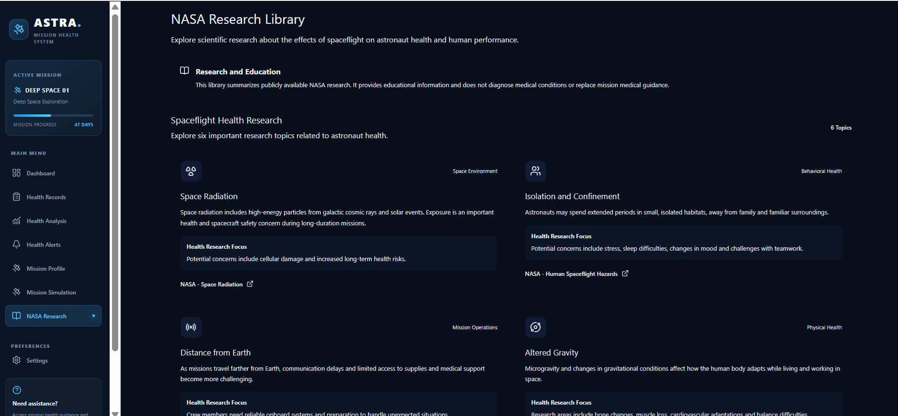

# ASTRA — Astronaut Health Monitoring & Risk Assessment System

**An independent, local-first health monitoring prototype designed around the challenges of long-duration human spaceflight.**

ASTRA helps users record health observations, understand changes relative to personal baselines, review transparent alerts, and explore simulated mission conditions through an integrated dashboard.

> **Important:** ASTRA is an educational hackathon prototype. It is not a medical diagnostic system, is not validated for clinical use, and is not affiliated with or endorsed by NASA. All demonstration mission information and simulated observations are synthetic.

---

## Project Overview

Long-duration space missions expose astronauts to challenging conditions, including:

- Space radiation
- Microgravity and altered gravity
- Isolation and confinement
- Hostile and closed environments
- Communication delays and distance from Earth

These conditions create important human-health research challenges.

ASTRA demonstrates how a digital health monitoring platform could help organize health observations, identify changes from an individual's historical baseline, and present understandable information for further review.

## Key Features

### 1. Health Dashboard
- Centralized health monitoring overview.
- Quick access to major application modules.
- Summary of available health information.

### 2. Health Records
- Record heart rate and blood pressure.
- Record body temperature and optional glucose.
- Track sleep, mood, stress and symptoms.
- View historical observations.
- Search, filter and delete records.

### 3. Health Analysis
- Calculate personal health baselines.
- Compare recent observations with historical averages.
- Identify noticeable changes using transparent demonstration rules.
- Display metric-level comparisons.

### 4. Health Alerts and Guidance
- Generate alerts based on the assessment results.
- Display understandable observations.
- Provide general recommended actions.
- Maintain alert history.

### 5. Mission Profile
- View demonstration mission information.
- Explore synthetic crew information.
- Review mission objectives and timeline.

### 6. Mission Simulation
Explore five synthetic mission scenarios:

- Normal Mission Conditions
- Elevated Radiation Exposure
- Extended Isolation
- Altered Gravity Conditions
- Combined Mission Challenges

The simulation generates illustrative environmental and health observations without modifying actual health records.

### 7. NASA Research Library
- Explore six educational topics related to human spaceflight.
- Read summaries of relevant health research.
- Access publicly available NASA research resources.

---

## Technology Stack

| Layer | Technologies |
|---|---|
| Frontend | React.js, Vite |
| Styling | CSS |
| Icons | Lucide React |
| Charts | Recharts |
| Backend | Node.js, Express.js |
| Database | SQLite |
| Database library | better-sqlite3 |
| API communication | REST API |
| Version control | Git and GitHub |

## System Architecture

```text
                 ASTRA APPLICATION
                         |
             React + Vite Frontend
                         |
                  REST API Calls
                         |
                Node.js + Express
                         |
              Application Services
                         |
       +-----------------+----------------+
       |                 |                |
 Health Records    Assessment Engine   Simulation
       |                 |                |
       +-----------------+----------------+
                         |
                    SQLite DB
                         |
                 Local Data Storage
```

## Project Structure

```text
ASTRA/
│
├── client/
│   ├── src/
│   │   ├── components/
│   │   │   ├── HealthRecords.jsx
│   │   │   ├── HealthTrends.jsx
│   │   │   ├── MissionProfile.jsx
│   │   │   ├── MissionSimulation.jsx
│   │   │   └── NASAResearch.jsx
│   │   │
│   │   ├── services/
│   │   │   └── healthApi.js
│   │   │
│   │   ├── App.jsx
│   │   └── App.css
│   │
│   └── package.json
│
├── server/
│   ├── database/
│   │   └── db.js
│   │
│   ├── routes/
│   │   ├── recordRoutes.js
│   │   ├── assessmentRoutes.js
│   │   ├── alertRoutes.js
│   │   └── simulationRoutes.js
│   │
│   ├── services/
│   │   ├── baselineService.js
│   │   ├── assessmentService.js
│   │   ├── alertService.js
│   │   └── simulationService.js
│   │
│   ├── index.js
│   └── package.json
│
├── .gitignore
├── PROJECT_CONTEXT.md
└── README.md
```

## Installation and Setup

### Prerequisites

Install:

- Node.js
- npm
- Git
- Visual Studio Code (recommended)

### 1. Clone the repository

```bash
git clone https://github.com/utsavimohite-arch/ASTRA.git
cd ASTRA
```

### 2. Install backend dependencies

```bash
cd server
npm install
```

### 3. Start the backend

```bash
node index.js
```

The backend runs at:

`http://localhost:5000`

### 4. Install frontend dependencies

Open a second terminal:

```bash
cd client
npm install
```

### 5. Start the frontend

```bash
npm run dev
```

Open the local URL printed by Vite in your browser.

## API Endpoints

| Method | Endpoint | Purpose |
|---

## Application Screenshots

### 1. Dashboard


### 2. Health Records


### 3. Health Analysis


### 4. Health Alerts


### 5. Mission Profile


### 6. Mission Simulation


### 7. NASA Research
